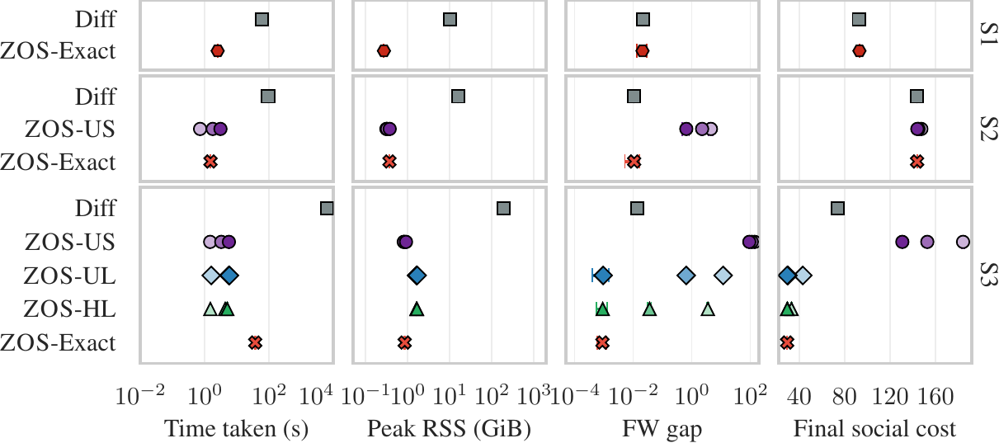

# Zeroth-Order Stackelberg Control in Combinatorial Congestion Games

Code for the NeurIPS 2026 paper by Saeed Masiha, Sepehr Elahi, Negar Kiyavash and Patrick Thiran (EPFL).

ZOS steers a congestion game toward low social cost by optimizing the leader's parameters with zeroth-order updates. Each query computes a Wardrop equilibrium with Frank–Wolfe, using an exact or subsampled combinatorial oracle.



*On three TNTP networks, ZOS reaches the social cost of the differentiable baseline (Diff) with 20–1000× less time per iteration and far less memory.*

## What's in this repository

| Path | Contents |
|---|---|
| `zos/zos.py` | ZOS outer loop (Algorithm 1) |
| `zos/frank_wolfe.py` | Frank–Wolfe equilibrium solver and FW gap |
| `zos/lmo.py`, `zos/zdd.py`, `zos/samplers.py` | Exact oracles (Dijkstra, ZDD) and subsampled oracles (US, UL, HL) |
| `zos/costs.py`, `zos/projection.py` | Cost model, social cost, projection onto Θ |
| `zos/certify.py` | Certified social cost (exact re-solve to FW gap ≤ 1e-8) |
| `zos/scenarios.py`, `zos/data/` | The three TNTP scenarios |
| `scripts/` | Run ZOS, certify iterates, check against the paper's runs |
| `tests/` | Unit and regression tests |

## Getting started

```bash
pip install -e ".[test]"
pytest
python scripts/run_zos.py --scenario 1 --seed 0 --out runs/s1.npz --certify
```

Options: `--oracle {exact,US,UL,HL}`, `--m`, `--K`, `--T`, `--rho`, `--eta`, `--B-out`, `--threads`. Defaults are the paper's settings. A full Scenario 1 run takes 30–60 minutes on 4 cores; Scenario 3 needs about 16 GB of memory to build its ZDD.

The experiments use Rademacher directions with factor 1/(2ρ) and projected queries (the default). Use `--directions sphere` for the unit-sphere estimator of Algorithm 1.

## Citation

```bibtex
@inproceedings{masiha2026zeroth,
  title     = {Zeroth-Order Stackelberg Control in Combinatorial Congestion Games},
  author    = {Masiha, Saeed and Elahi, Sepehr and Kiyavash, Negar and Thiran, Patrick},
  booktitle = {Advances in Neural Information Processing Systems},
  year      = {2026}
}
```

## License

MIT. The TNTP network data are from the [Transportation Networks for Research](https://github.com/bstabler/TransportationNetworks) repository, which allows academic research use with attribution.
